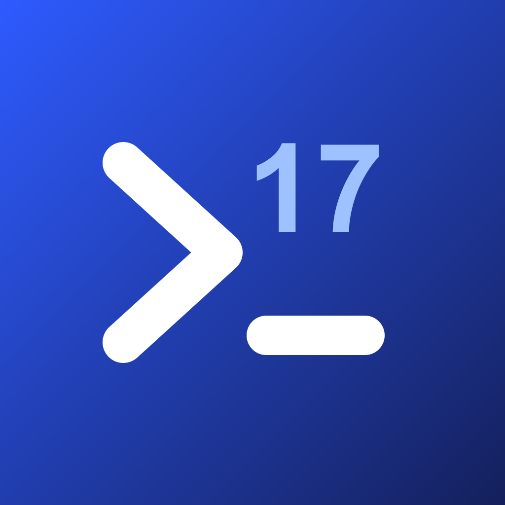

<p align="center">
  
</p>

<h1 align="center">Remote17</h1>
<p align="center"><b>Unofficial iOS 17 build of the open-source T3 Code mobile client</b><br>
Tuned for older iPhones and iPads, such as the iPad 6 (A10, 2 GB RAM)</p>

> [!WARNING]
> **This is an UNOFFICIAL fork.** It is **not affiliated with, endorsed, sponsored or supported by
> T3 Tools, Inc., Ping Labs, or the T3 Code maintainers.** "T3 Code" is used here only to describe
> the original project: <https://github.com/pingdotgg/t3code>.
>
> The software is provided **"AS IS", without warranty of any kind** (see [LICENSE](LICENSE)).
> **iOS 17 compatibility is not guaranteed.** Installing apps outside the App Store requires a
> jailbroken device; doing so is entirely **at your own risk** (data loss, instability, voided
> support). For the official app, use the App Store version published by its developers.
>
> Please do not report problems with this fork to the official T3 Code project. Use this
> repository's [Issues](../../issues) instead.

---

## What is it?

T3 Code is an MIT-licensed GUI for coding agents (Codex, Claude Code, Cursor, OpenCode, ...).
Its desktop app or `npx t3` server runs on your computer, and the mobile app lets you follow and
control that work remotely.

The official mobile app requires **iOS 18**. This fork rebuilds the same open-source mobile client
so it can be installed on **iOS 17.0+**, under its own name (**Remote17**) and with a generic icon,
plus a few changes for old, low-memory hardware:

| Change | Why |
|---|---|
| Deployment target lowered from iOS 18.0 to **17.0** | Install on iPad 6 / iPhone 8 / iPhone X class devices stuck on iOS 17 |
| **Performance mode** (automatic on iOS < 18 or ≤ 3 GB RAM) | No live blur, no large shadows, reduced motion, fewer list rows rendered ahead, image cache freed on memory warnings |
| No widgets, share extension, push or Sign in with Apple | These need an Apple developer team and app groups; leaving them out also saves memory |
| No over-the-air updates, no T3 cloud keys, no crash reporting server | The build only talks to the T3 Code server you pair it with (see [Privacy](#privacy)) |
| No third-party favicon lookups | Website icons in agent activity are not fetched from Google or other sites |

The full list is in [CHANGES.md](CHANGES.md).

## Status

| | |
|---|---|
| Source changes | Done, type-checked; Expo prebuild verified (all targets iOS 17.0) |
| Build | Built on Codemagic from [`codemagic.yaml`](codemagic.yaml) (a GitHub Actions workflow with the same steps is also included) |
| Downloadable IPA | In [Releases](../../releases) |
| Tested on a real iOS 17 device | iPad 6 (A10, 2 GB) on iOS 17, jailbroken. Other devices not tested |

## Requirements

- An iPhone or iPad on **iOS 17.0 – 17.x** that is **jailbroken** (for example an iPad 6, which
  checkm8-based jailbreaks support), with:
  - **AppSync Unified** (lets the system install IPAs that are not signed by Apple)
  - **Filza File Manager** (opens and installs the `.ipa`)
- A computer running **T3 Code** (desktop app, or `npx t3` / `t3 serve`) that the device can reach
  on your **local network or Tailscale**.

## Install the IPA (jailbreak + AppSync Unified + Filza)

1. In your package manager (Sileo / Zebra), add the AppSync Unified repository
   `https://cydia.akemi.ai/` and install **AppSync Unified**. Install **Filza File Manager**
   from its usual repository. Respring when asked.
2. Download `Remote17-iOS17-adhoc-signed.ipa` from this repository's
   [Releases](../../releases) in Safari. Check its SHA-256 against
   `SHA256SUMS.txt` if you want to be sure the file is intact.
3. Open the Files app → **Downloads**, long-press the IPA → **Share** → **Filza**, or browse to it
   inside Filza (`/var/mobile/Containers/Shared/AppGroup/.../File Provider Storage/Downloads`).
4. Tap the IPA in Filza → **Install**. Wait for "Done", then return to the home screen.
   If the icon does not appear (the app is listed in Settings → General → iPad Storage), run
   `uicache -a` in a terminal (NewTerm), or install the IPA with **TrollStore Lite** instead.
5. If the ad-hoc signed variant does not install or launch, try `Remote17-iOS17-unsigned.ipa`
   the same way.

To uninstall, long-press the Remote17 icon → **Remove App**, like any other app.

## Connect to your computer

Remote17 connects directly to your own T3 Code server; no account is needed.

1. On the computer: in the T3 Code desktop app open **Settings → Sharing & access**, enable
   **Network access**, and create a pairing link. With the CLI, run `t3 up --lan` (or
   `t3 serve --lan`) and then `t3 pair`.
2. On the iPad/iPhone: open Remote17 → **Add environment**, then scan the QR code or paste the
   pairing URL. Use an address the device can reach (LAN IP or Tailscale address, not
   `127.0.0.1`).

Details: [Remote access](docs/user/remote-access.md) in the original documentation.

## Performance mode

**Settings → Appearance → Performance.** "Automatic" turns it on when the device runs an iOS
version older than 18 or has 3 GB of RAM or less. You can force it on or off. It also makes the
app report "Reduce Motion" to its own animations, so everything stays responsive on an A10.

## Known limitations

- **T3 account sign-in and T3 Connect are not available.** They depend on the official cloud
  service (Clerk sign-in and the T3 relay), which only accepts the official apps' identifiers.
  This fork does not imitate those identifiers and does not try to get around that; use LAN or
  Tailscale pairing instead.
- No home-screen widgets, no share-sheet extension, no push notifications or Live Activities.
- Features that need iOS 26 (Apple on-device voice transcription, "liquid glass") are not
  available on iOS 17; the app falls back to the iOS 17 look.
- Built with the current Xcode SDK for a minimum of iOS 17.0. Compile-time availability checks
  cover Swift code, but some native libraries could still behave differently on iOS 17.
  Please report crashes in [Issues](../../issues) with the device model and iOS version.
- Newer T3 Code servers may require a newer client; the app will say so when that happens.

## Privacy

Remote17 does not include analytics, advertising, or crash-reporting services, and it does not
send anything to the fork maintainer. It connects to:

| Destination | When | Why |
|---|---|---|
| **Your T3 Code server** (the address you pair) | Always, while in use | The app's whole purpose: threads, files, terminals, diffs |
| Sites linked from content you open | Only when you open them | Images or links inside messages and pull requests are loaded from their original hosts (for example GitHub) |
| Apple services | As the OS decides | Standard iOS behaviour (for example network checks), not app-specific |

Not used in this build: T3 Connect relay (`relay.t3.codes`), Clerk sign-in (`clerk.t3.codes`),
Expo updates (`u.expo.dev`), Expo push, Axiom tracing, PostHog, Google favicon service. The CI
workflow fails the build if T3 cloud identifiers end up in the configuration.

Your T3 Code server has its own telemetry settings; see the original
[telemetry documentation](docs/user/telemetry.md).

## Build it yourself

The IPA is built by GitHub Actions on `macos-latest` with no signing and no secrets:

```bash
gh workflow run remote17-ios17-ipa.yml --ref ios17-legacy -f configuration=Release
```

It runs `expo prebuild`, checks that every target is iOS 17.0 or lower, builds with
`xcodebuild … CODE_SIGNING_ALLOWED=NO`, checks every binary's minimum iOS version, and uploads two
`.ipa` files (unsigned and ad-hoc signed) plus `SHA256SUMS.txt` as artifacts.

Without GitHub Actions, the same build runs on [Codemagic](https://codemagic.io) (free tier):
sign in with GitHub, add this repository, and start the `remote17-ios17-ipa` workflow from
[`codemagic.yaml`](codemagic.yaml). The `.ipa` files appear under the build's artifacts.

On a Mac, the same steps by hand:

```bash
pnpm install --filter=@t3tools/mobile... --filter=@t3tools/scripts...
cd apps/mobile
APP_VARIANT=production npx expo prebuild --platform ios --clean
# then build the generated ios/Remote17.xcworkspace with CODE_SIGNING_ALLOWED=NO
```

`REMOTE17_FORK_BUILD=0` restores the original configuration.

## Licenses and credits

- Original work: **T3 Code**, © 2026 T3 Tools Inc., MIT License — kept unchanged in
  [LICENSE](LICENSE). All original copyright notices are preserved.
- Fork changes: MIT License, same terms.
- Third-party components: see [THIRD-PARTY.md](THIRD-PARTY.md) and the in-app
  **Settings → About → Open source licenses**.
- The Remote17 icon is original artwork made for this fork. "T3", "T3 Code" and related logos are
  trademarks of their respective owners and are not used as this project's identity.
- Legal review notes: [LEGAL-CHECK.md](LEGAL-CHECK.md) (not legal advice).

## Removal on request

If the owners of the original project, of any trademark, or of any service involved disagree with
this fork, **the maintainer will delete it or make it private**. Please open an
[Issue](../../issues) in this repository (or mention `Xillo23` on GitHub); requests are handled
promptly and without argument.

